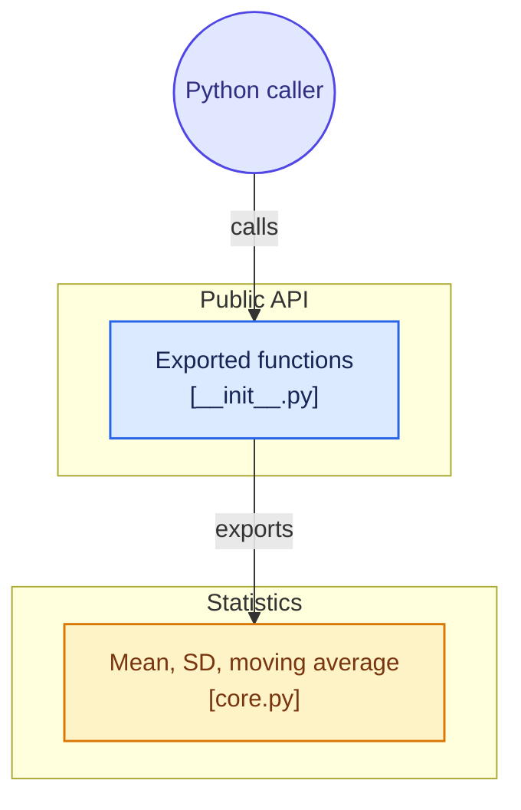

# IOSS: Interactive Open Source Simulator

> Learn to contribute to research software by playing through real workflows, in a safe sandbox, with humans first and LLMs as backup.

## Idea & problem

Joining a research software project is hard for newcomers. The technical side is hard: setting up the environment, finding your way around the codebase, understanding dependencies. The social side is hard too: knowing who does what, how issues, pull requests and reviews actually work, and what reviewers expect. Documentation is usually scattered and assumes prior knowledge. Remote and hybrid settings add another problem: feedback from peers and instructors arrives slowly and is awkward to give. An LLM is always available, so learners turn to it and stop talking to people.

**IOSS** is a simulator that turns a real research software repository into a safe practice ground. Newcomers play through the contribution workflow inside a simulated community. A shared learning notebook links each step to learning goals, questions, feedback and reflection.

## How it works: three layers

### 1. Repo layer: guided onboarding

IOSS takes an existing research software repository and generates a guided onboarding path from it:

- environment setup steps
- a map of the project structure
- codebase exploration tasks
- a suggested first contribution, such as a docs fix, a small test or a good-first-issue

All of this runs in a **sandbox**: a local copy of the repo with a mock issue tracker. Nothing reaches the real project.

### 2. Community layer: the game

A game wraps the workflow: **issue → branch → pull request → review → revision → merge**.

Each community role is a character:

| Role | Played by |
|---|---|
| Newcomer | The player |
| Reviewer | Peer or LLM |
| Maintainer | Peer or LLM |
| CI bot | Scripted |
| Fellow contributor | Peer or LLM |

The player starts as the newcomer. Later scenarios switch roles ("now you review someone else's PR", "now you're the maintainer triaging issues"). When no human is available, an LLM plays the role, and its style can be set (helpful, terse, picky) so players also learn the social dynamics.

### 3. Reflection layer: shared learning notebook

A shared notebook with code support, such as Jupyter or Marimo, runs alongside the game. It holds:

- learning goals
- open questions
- tasks and work in progress
- feedback from peers and experts
- short reflections

Game milestones prompt entries automatically. For example, after your first review comment, the notebook asks: *"What was unclear in the feedback you received?"* Peers and mentors comment directly on these entries. The LLM can help draft or explain, but only humans give the feedback that counts.

## Design principle

**Human to human by default.** The LLM is a stand-in and a helper, never the main way people interact. Roles are filled by peers first and by AI second. Expert feedback stays human.

## Hackathon scope

One repository, one scenario: **a newcomer's first contribution**, from issue to merge.

Notebook checkpoints tied to four learning goals:

1. Set up the environment
2. Understand the project structure
3. Make a change following the contribution guidelines
4. Respond to review

### Practice repository: tinystats

The scenario uses [tinystats](https://github.com/florence-bockting/tinystats), a small Python package for statistics. It is a Git submodule in `projects/tinystats`.

[GitDiagram](https://gitdiagram.com/florence-bockting/tinystats) generated this architecture diagram. Generate it again there after a change to the structure of tinystats.

## Group

Online. Suggested workstreams:

- Repo analysis and onboarding generation
- Game engine and scenario script
- LLM role-players
- Notebook and feedback workflow
- Spec writing and testing

## Outcome

- [ ] **Specification** covering the three layers, the roles, the scenario format and the human/LLM interaction rules
- [ ] **Playable prototype** (if time allows) of the first-contribution scenario on one real repo, including the linked notebook
- [ ] **Follow-up** (if promising): continue as a small open source project, built in a test-driven way

## Future scenarios

- You are the reviewer
- You are the maintainer
- You are the release manager
- Handling a difficult discussion

## Open questions

- How simulated should the sandbox be? A fully mocked GitHub-like UI, or a real local Git forge such as Forgejo with scripted actors?
- How much of the onboarding can be generated automatically from any repo, and how much needs a hand-written scenario per project?
- What does a mentor or instructor see and do in the notebook, and how do we keep their workload low?

## Origins

IOSS combines three hackathon pitches:

1. **Research Software Onboarding Simulator:** guided onboarding generated from a real repo
2. **Open-source community game:** learning roles and workflows by playing
3. **Shared learning notebook:** connecting goals, tasks, feedback and reflection, human to human first
